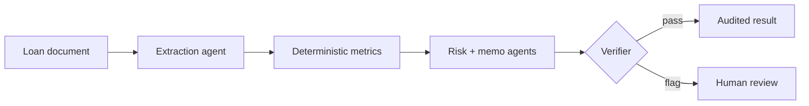
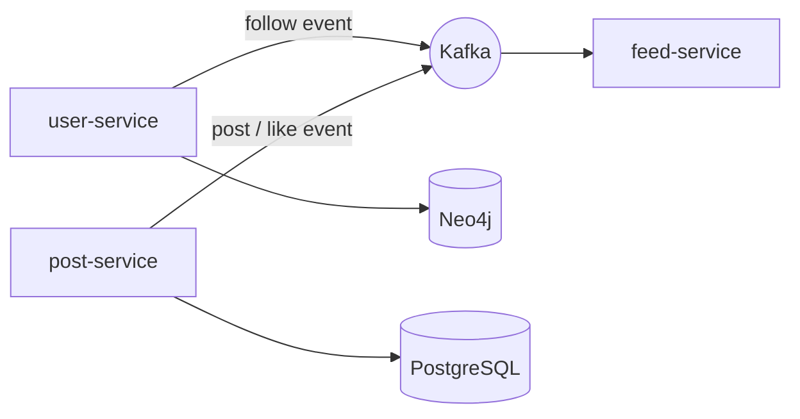
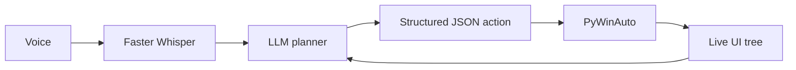

<div align="center">

<a href="https://github.com/vishnusangadala?tab=repositories">
  
</a>

<br/>

[](#hello)
[](#selected-work)
[](#under-the-hood)
[](#toolbox)
[](#engineering-activity)

</div>

<a id="hello"></a>

## `$ whoami`

```yaml
name: Vishnu Sangadala
role: Software Engineer
focus: [Java Backends, C++ Systems, CUDA, Distributed Systems, AI Automation]
experience: 2+ years
education: MS in Data Science — Stony Brook University
currently_building: reliable systems where performance and intelligence meet
```

I design software across three layers: **services that scale**, **native code that moves fast**, and **automation that can reason about an interface before acting**. My work ranges from Spring Boot microservices and Kafka pipelines to custom CUDA kernels and voice-driven Windows automation.

<div align="center">

[](https://www.linkedin.com/in/vishnusangadala/)
[](https://github.com/vishnusangadala?tab=repositories)
[](https://github.com/vishnusangadala)

</div>

---

<a id="selected-work"></a>

## Selected work

<p align="center"><i>Click a card to open the repository. Expand a build note below for the engineering story.</i></p>

<table>
  <tr>
    <td width="50%">
      <a href="https://github.com/vishnusangadala/cuda-image-processing">
        
      </a>
    </td>
    <td width="50%">
      <a href="https://github.com/vishnusangadala/creditflow-ai">
        
      </a>
    </td>
  </tr>
  <tr>
    <td width="50%">
      <a href="https://github.com/vishnusangadala/Distributed_Social_Networking">
        
      </a>
    </td>
    <td width="50%">
      <a href="https://github.com/vishnusangadala/UI-automation">
        
      </a>
    </td>
  </tr>
</table>

<details>
<summary><b>⚡ Build note: CUDA Image Processing Accelerator</b> — what makes it more than a demo</summary>

### A benchmarkable CPU/GPU pipeline

The application implements grayscale conversion, Gaussian blur, and Sobel edge detection through matched **C++/OpenCV** and **custom CUDA** paths.

- Shared-memory halo tiles and constant-memory Gaussian coefficients
- CUDA-event timing split into transfer, kernel, and download phases
- CPU/GPU maximum-error validation, including non-block-aligned images
- Multi-resolution benchmark runner with CSV output
- CMake presets, development container, tests, and CPU-only CI

```text
image ─┬─> C++ / OpenCV reference ──────────────┐
       └─> upload ─> CUDA kernel ─> download ───┼─> verify + benchmark + report
```

[Open the CUDA project →](https://github.com/vishnusangadala/cuda-image-processing)

</details>

<details>
<summary><b>🏦 Build note: CreditFlow AI</b> — deterministic finance inside an agentic workflow</summary>

### Evidence in, verified decisions out

Five agents extract loan terms, calculate risk ratios, assess risk, draft a credit memo, and verify the result. Financial calculations stay in deterministic Python; questionable cases stop at `NEEDS_REVIEW` for a human decision.



`Java 21` · `Spring Boot` · `PostgreSQL` · `Python` · `FastAPI` · `LangGraph` · `React`

[Open CreditFlow AI →](https://github.com/vishnusangadala/creditflow-ai)

</details>

<details>
<summary><b>📊 Bonus build: LLM Inference Benchmark</b> — performance claims with evidence</summary>

A reproducible benchmark for vLLM and PyTorch/Transformers across batch sizes, prompt lengths, and generation lengths. It records TTFT, inter-token latency, throughput, GPU utilization, and peak GPU memory, then exports raw JSON/CSV and Prometheus metrics.

[Open the benchmark →](https://github.com/vishnusangadala/llm-inference-benchmark)

</details>

---

<a id="under-the-hood"></a>

## Under the hood

<details open>
<summary><h3>☕ Java backend engineering</h3></summary>

I build Java 17/21 services with **Spring Boot**, explicit API contracts, and ownership boundaries that stay understandable as a system grows.

| Design concern | How I approach it |
|---|---|
| Service boundaries | Independent services and data ownership instead of shared persistence |
| Communication | REST for direct requests; Kafka for asynchronous domain events |
| Data | PostgreSQL for relational content, Neo4j for graph relationships, Redis for low-latency access |
| Reliability | Validation, DTO boundaries, testable service layers, audit trails, and visible failure states |
| Delivery | Maven, Docker, Kubernetes, CI/CD, and reproducible local environments |



[Inspect the Java microservices project →](https://github.com/vishnusangadala/Distributed_Social_Networking)

</details>

<details>
<summary><h3>⚡ C++ and CUDA systems</h3></summary>

I use modern C++ and CUDA when latency, throughput, and memory behavior are part of the product—not implementation details.

- Native C++17 design with CMake and clear CPU/GPU abstractions
- Custom kernels, coalesced access, shared-memory tiling, and CUDA event timing
- Correctness comparisons before performance claims
- Warmups, repeated measurements, raw artifacts, and hardware-aware reporting

> My rule: **benchmark the complete path, publish the method, and never invent the speedup.**

[Inspect the CUDA implementation →](https://github.com/vishnusangadala/cuda-image-processing)

</details>

<details>
<summary><h3>🖥️ AI-powered UI automation</h3></summary>

My Windows desktop agent converts spoken requests into inspectable UI actions. Rather than guessing coordinates, it grounds each decision in the live accessibility tree.



The loop performs one action, reads the interface again, and continues only from the updated state. Hotkey recording, a tray interface, and spoken feedback make it usable as a desktop assistant.

`Python` · `LangChain` · `LangGraph` · `Faster Whisper` · `Windows UIA` · `PyWinAuto`

[Inspect the UI automation tool →](https://github.com/vishnusangadala/UI-automation)

</details>

---

<a id="toolbox"></a>

## Toolbox

<div align="center">

### Core

[](https://skillicons.dev)

### Performance, AI & product

[](https://skillicons.dev)

`CUDA` · `vLLM` · `LangGraph` · `Neo4j` · `Prometheus` · `REST APIs` · `Microservices` · `CI/CD`

</div>

<details>
<summary><b>My engineering operating system</b></summary>

```text
01  Make ownership explicit        04  Measure before optimizing
02  Keep deterministic logic testable
03  Verify probabilistic output    05  Leave an evidence trail
```

</details>

---

<a id="engineering-activity"></a>

## Engineering activity

<div align="center">

<picture>
  <source media="(prefers-color-scheme: dark)" srcset="https://github-readme-stats.vercel.app/api?username=vishnusangadala&show_icons=true&hide_border=true&theme=github_dark&rank_icon=github&include_all_commits=true">
  <source media="(prefers-color-scheme: light)" srcset="https://github-readme-stats.vercel.app/api?username=vishnusangadala&show_icons=true&hide_border=true&theme=default&rank_icon=github&include_all_commits=true">
  
</picture>

<picture>
  <source media="(prefers-color-scheme: dark)" srcset="https://streak-stats.demolab.com?user=vishnusangadala&theme=github-dark-blue&hide_border=true">
  <source media="(prefers-color-scheme: light)" srcset="https://streak-stats.demolab.com?user=vishnusangadala&theme=default&hide_border=true">
  
</picture>

<br/>

<picture>
  <source media="(prefers-color-scheme: dark)" srcset="https://github-profile-summary-cards.vercel.app/api/cards/profile-details?username=vishnusangadala&theme=github_dark">
  <source media="(prefers-color-scheme: light)" srcset="https://github-profile-summary-cards.vercel.app/api/cards/profile-details?username=vishnusangadala&theme=github">
  
</picture>

</div>

---

<div align="center">

### Have a backend, performance, or automation problem worth solving?

[](https://www.linkedin.com/in/vishnusangadala/)
[](https://github.com/vishnusangadala?tab=repositories)

<sub>Built with systems thinking, measurable evidence, and an unreasonable dislike of vague claims.</sub>

</div>
